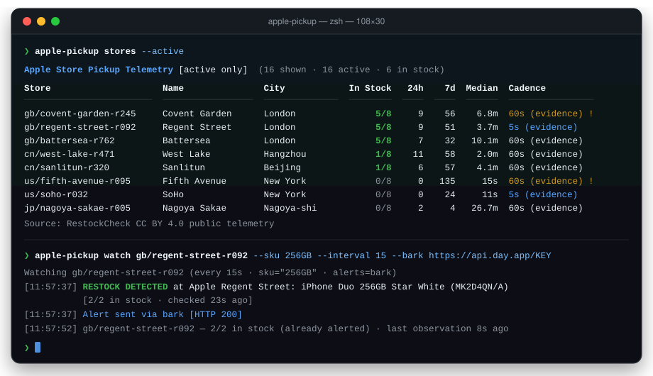

# apple-pickup-cli

Zero-API-key terminal CLI for live Apple Store in-store pickup availability, recent restock windows, and instant Bark / Discord / Slack / Telegram webhook alerts.

[](./LICENSE)
[](https://nodejs.org/)
[](./package.json)
[](https://creativecommons.org/licenses/by/4.0/)



Powered exclusively by public, anonymous, read-only CC BY 4.0 JSON telemetry — no Apple account, no browser scraping, and no API keys required.

---

## Quick Start

Requires **Node.js 20+** and **pnpm**.

```bash
git clone https://github.com/yangjwlove-dev/apple-pickup-cli.git
cd apple-pickup-cli
pnpm install && pnpm build
```

Run directly with `node dist/cli.js` (or link globally with `pnpm link --global` to use `apple-pickup` anywhere):

```bash
# 1. List actively monitored Apple Stores with live in-stock SKU counts and 24h/7d restocks
apple-pickup stores --active

# 2. Filter monitored stores by country (us | gb | jp | cn) or output JSON for scripts
apple-pickup stores --country gb --active

# 3. Inspect per-SKU pickup availability and recent restock windows at one store
apple-pickup check gb/regent-street-r092 --sku 256GB

# 4. Watch a store with deduplicated alerts (minimum safe interval: 10s)
apple-pickup watch us/soho-r032 --interval 15 --once
```

---

## Commands

### `apple-pickup stores [--country us|gb|jp|cn] [--active] [--json]`

Prints an aligned table (or JSON) of monitored hub Apple Stores across the US, UK, Japan, and China with:

- Live in-stock SKU ratio (`available/total`)
- `24h` and `7d` restock transition counts
- Median in-stock sellout duration
- Current polling cadence (`5s`, `60s`, or `paused`)

### `apple-pickup check <country>/<slug> [--sku <filter>] [--json]`

Displays live per-configuration pickup availability and up to 10 recent restock transitions for a specific store. `--sku` matches part numbers, capacity, or color (case-insensitive, e.g. `--sku MK2D4QN/A`, `--sku 256GB`, or `--sku "Star White"`).

### `apple-pickup watch <country>/<slug> [--sku <filter>] [--interval 15] [--bark <url>] [--webhook <url>] [--once]`

Polls a store's public telemetry endpoint cleanly:

- **Safe interval bounds:** enforces `--interval` between `10` and `86400` seconds (values below `10` are automatically clamped to `10s`; values above `86400` are rejected).
- **Per-SKU deduplication:** if matching SKUs are already in stock on startup, the first poll alerts immediately (once per SKU), stays silent while they remain available, and only re-alerts if they sell out and restock again. Transient network errors or `unknown` observations never wipe dedupe state.
- **Terminal & webhook alerts:** rings the terminal bell (on interactive TTYs) and dispatches optional `--bark` and/or `--webhook` notifications.
- **Cron / CI friendly:** pass `--once` to execute a single check cycle and exit immediately (exits non-zero on poll failure or if all configured alert channels fail).

### `apple-pickup report [--json]`

Prints live CC BY 4.0 polling freshness quantiles (`P50 / P90 / P95` check interval and observation age by polling tier) alongside email/push alert dispatch latency quantiles.

---

## Webhook & Push Alert Examples

`apple-pickup watch` auto-detects **Discord**, **Slack**, and **Telegram** webhook URLs and formats native payloads automatically. Any other HTTP(S) URL receives a clean JSON event payload.

### Bark (iOS Push)

```bash
apple-pickup watch gb/regent-street-r092 \
  --sku 256GB \
  --interval 15 \
  --bark "https://api.day.app/YOUR_BARK_DEVICE_KEY"
```

### Discord Webhook

```bash
apple-pickup watch us/soho-r032 \
  --interval 15 \
  --webhook "https://discord.com/api/webhooks/WEBHOOK_ID/WEBHOOK_TOKEN"
```

### Slack Incoming Webhook

```bash
apple-pickup watch us/fifth-avenue-r095 \
  --sku "Star White" \
  --interval 15 \
  --webhook "https://hooks.slack.com/services/<WORKSPACE_ID>/<CHANNEL_ID>/<WEBHOOK_TOKEN>"
```

### Telegram Bot API

Pass `chat_id` in the query string; the CLI extracts it into the JSON request body and sends HTML-formatted alerts:

```bash
apple-pickup watch cn/sanlitun-r320 \
  --interval 15 \
  --webhook "https://api.telegram.org/botYOUR_BOT_TOKEN/sendMessage?chat_id=YOUR_CHAT_ID"
```

### Generic JSON Webhook

Any other URL receives an HTTP `POST` with `Content-Type: application/json`:

```json
{
  "event": "restock",
  "source": "apple-pickup-cli",
  "country": "gb",
  "slug": "regent-street-r092",
  "storeId": "R092",
  "storeName": "Regent Street",
  "city": "London",
  "checkedAt": "2026-11-25T11:57:14.000Z",
  "title": "Apple Regent Street (London): 1 SKU in stock",
  "skus": [
    {
      "sku": "MK2D4QN/A",
      "name": "iPhone Duo 256GB Star White (MK2D4QN/A)",
      "availability": "available",
      "capacity": "256GB",
      "color": "Star White"
    }
  ]
}
```

---

## Open-Core & Hosted Monitoring

Run this MIT CLI locally forever for free. Don't want to leave a terminal running? Hosted 5-second monitoring with email & browser push alerts is available on [RestockCheck](https://restockcheck.com/), with live freshness and dispatch latency published on the [Service Report](https://restockcheck.com/service-report).

### Public Read-Only Telemetry & Archived Datasets

The CLI commands query three anonymous CC BY 4.0 JSON endpoints using `User-Agent: apple-pickup-cli/0.1.0`:

- `GET /api/stock/public/stores` (`stores`)
- `GET /api/stock/public/store/<country>/<slug>` (`stores`, `check`, `watch`)
- `GET /api/stock/public/service-report` (`report`)

An additional summary endpoint (`GET /api/stock/public/summary`) is available programmatically via the exported `fetchSummary()` helper.

Archived historical CC BY 4.0 snapshots for researchers and analysts are published with persistent DOIs:

- **Zenodo:** [doi:10.5281/zenodo.24523167](https://zenodo.org/records/24523167)
- **Harvard Dataverse:** [doi:10.7910/DVN/MZFTCB](https://dataverse.harvard.edu/dataset.xhtml?persistentId=doi:10.7910/DVN/MZFTCB)

---

## Development

```bash
pnpm typecheck   # TypeScript strict check
pnpm build       # Compile ESM output to dist/
pnpm test        # Run Vitest unit test suite
pnpm smoke       # Run live read-only smoke test (stores, report, watch --once)
```

## License

Code is licensed under the [MIT License](./LICENSE). Public telemetry data consumed by this CLI is licensed under [CC BY 4.0](https://creativecommons.org/licenses/by/4.0/).
